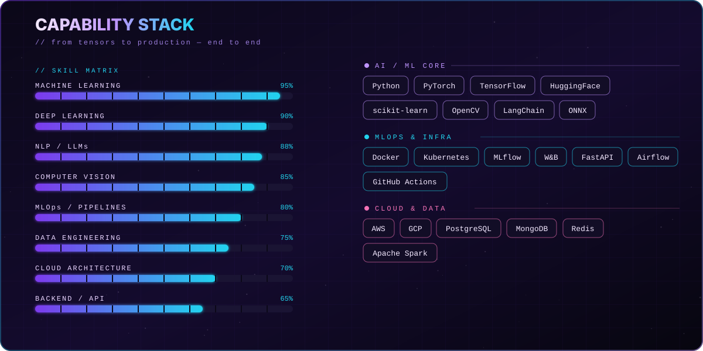
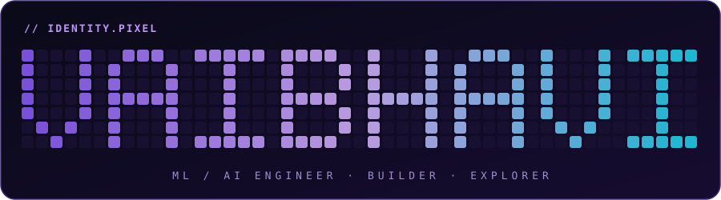

<div align="center">


<a href="https://git.io/typing-svg"></a>

<p>
<a href="#about"></a>
<a href="#stack"></a>
<a href="#galaxy"></a>
<a href="#leetcode"></a>
<a href="#activity"></a>
<a href="#shipping"></a>
<a href="#contact"></a>
</p>


<a href="https://github.com/webhavi?tab=followers"></a>
<a href="https://leetcode.com/u/vaibhavisharnagat/"></a>

<br/><br/>


</div>


<a id="about"></a>

## 🌌 About

<div align="center">

</div>

<details>
<summary><b>🐍 &nbsp;Prefer code? Expand <code>whoami.py</code></b></summary>

```python
class Vaibhavi:
    def __init__(self):
        self.name         = "Vaibhavi Sharnagat"
        self.role         = "ML / AI Engineer"
        self.location     = "🌍 Earth (mostly online)"
        self.languages    = ["Python", "C++", "SQL", "Bash"]
        self.focus        = ["LLMs", "Computer Vision", "MLOps", "GenAI"]
        self.currently    = "Building intelligent systems that actually work"
        self.learning     = ["Agent frameworks", "RLHF", "Diffusion models"]
        self.ask_me_about = ["ML pipelines", "model fine-tuning", "research papers"]
        self.fun_fact     = "I debug neural nets at 2AM and somehow enjoy it 🤖"

    def say_hi(self):
        print("Thanks for stopping by! Let's build something extraordinary.")

Vaibhavi().say_hi()
```

</details>


<a id="stack"></a>

## 🧬 Capability Stack

<div align="center">

<br/>

</div>

<details>
<summary><b>🧩 &nbsp;Clickable badge wall</b></summary>
<br/>
<div align="center">


</div>
</details>


<a id="galaxy"></a>

## 🪐 Skill Galaxy

<div align="center">

<br/>
<sub>🛰️ Three orbits: models → frameworks → infrastructure. Nodes shrink and fade as they swing behind the core.</sub>
</div>


<a id="leetcode"></a>

## 🟠 LeetCode

<div align="center">
<a href="https://leetcode.com/u/vaibhavisharnagat/"></a>

<a href="https://leetcode.com/u/vaibhavisharnagat/"></a>
<a href="https://leetcode.com/u/vaibhavisharnagat/"></a>
<a href="https://leetcode.com/u/vaibhavisharnagat/"></a>
<a href="https://leetcode.com/u/vaibhavisharnagat/"></a>
<a href="https://leetcode.com/u/vaibhavisharnagat/"></a>
</div>

<details>
<summary><b>📡 &nbsp;Live LeetCode card (auto-updates)</b></summary>
<br/>
<div align="center">

[](https://leetcode.com/u/vaibhavisharnagat/)

</div>
</details>


<a id="trophies"></a>

## 🏆 Trophy Cabinet

<div align="center">

</div>


<a id="activity"></a>

## 🧊 3D Contribution Graph

<div align="center">

</div>

<details>
<summary><b>🎛️ &nbsp;Switch themes</b></summary>
<br/>
<div align="center">

**Green · animated**


**Season · animated**


**Night green**


**Git block**


</div>
</details>

### 🐍 Contribution Snake

<div align="center">
<picture>
  <source media="(prefers-color-scheme: dark)" srcset="https://raw.githubusercontent.com/webhavi/webhavi/output/github-snake-dark.svg"/>
  <source media="(prefers-color-scheme: light)" srcset="https://raw.githubusercontent.com/webhavi/webhavi/output/github-snake.svg"/>
  
</picture>
</div>

### 📊 GitHub Intelligence Report

<div align="center">


</div>


<a id="shipping"></a>

## 🚀 Currently Shipping

<div align="center">

</div>

<details>
<summary><b>📋 &nbsp;Plain-text version</b></summary>
<br/>

| Project | Stack | Status |
|:--------|:------|:------:|
| 🧠 LLM Fine-tuning Pipeline | PyTorch · HuggingFace · LoRA | 🟢 Active |
| 👁️ Vision Transformer Research | ViT · CLIP · OpenCV | 🟡 WIP |
| 🤖 AI Agent Framework | LangChain · FastAPI · Redis | 🟢 Active |
| 📊 ML Monitoring Dashboard | MLflow · Grafana · Docker | 🔵 Beta |

</details>


<a id="contact"></a>

## 🌐 Find Me

<div align="center">



<br/>

[](https://github.com/webhavi)
[](https://leetcode.com/u/vaibhavisharnagat/)
[](https://linkedin.com/in/vaibhavi-sharnagat-080083332)
[](https://kaggle.com/vaibhavisharnagat)
[](https://huggingface.co/vaibhavisharnagat)
[](mailto:vaibhavi@email.com)

<br/>


</div>
